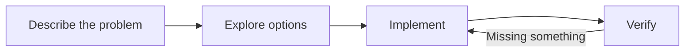

# OpenCode Session Document

A living Markdown document for each OpenCode session. Follow the objective, approach,
decisions, progress, and blockers without losing the thread of the conversation.

- **Session-scoped:** two sessions in the same folder have different documents.
- **Automatic:** enable once, then opening a session creates its document and completed chat turns trigger a background update.
- **Low friction:** the document tab appears on first visit, without replacing another visible panel. Closing it is remembered.
- **Editable:** switch the panel into edit mode and change the Markdown yourself.
- **Visual:** Markdown preview, tables, code blocks, and rendered Mermaid diagrams.
- **Conflict-aware:** manual saves use revision checks; background updates never commit over a newer revision.

This is a prototype targeting **OpenCode V2**, developed against the published
`@opencode/plugin` **2.2.0**. The desktop GUI plugin API is experimental. V1 is not supported.

## Install with OpenCode

The private Git repository includes the prebuilt desktop GUI. **No manual clone,
`npm ci`, GUI build, or configuration editing is needed for a package installation.**
You need OpenCode V2 and Git access to this private repository on each machine.

With working HTTPS Git credentials:

```sh
opencode plugin add 'git+https://github.com/dluc/opencode-session-document.git#main'
```

If you use GitHub CLI, configure HTTPS Git authentication once before installing:

```sh
gh auth login
gh auth setup-git
```

Alternatively, with SSH access already configured:

```sh
opencode plugin add 'git+ssh://git@github.com/dluc/opencode-session-document.git#main'
```

Choose **one** URL form and keep using it for updates/removal. A GitHub CLI login
alone does not necessarily configure SSH. Never put a token in the installation URL.

**Desktop connected to a remote server:** run the installation on **both** the
laptop/desktop and the remote session server. The desktop's own server loads the
panel; the remote server runs document updates and stores the documents. Global
configuration reloads automatically. The one-time **Enable automatic documents**
action and model-cost notice still apply.

Verify, check for updates, and update this plugin (HTTPS example):

```sh
opencode plugin list
opencode plugin check
opencode plugin update 'git+https://github.com/dluc/opencode-session-document.git#main'
```

To remove a package installation:

```sh
opencode plugin remove 'git+https://github.com/dluc/opencode-session-document.git#main'
```

The `#main` branch tracks the latest prototype. A full Git commit hash can be used
instead when you need a pinned installation; pinned revisions are not updated by
`plugin update`. The repository remains private and is not published to npm.
No Bash wrapper is required; the native CLI performs installation and registration.

Native HTTPS Git installation and updates were verified with **OpenCode 2.2.1**
using isolated configuration, data, and cache directories. The smoke test checked
server/RPC/GUI activation, the served GUI bundle against the committed file,
document create/save/read over HTTP RPC, and document preservation across a Git
package update. Automation stayed disabled, so the test made no paid model requests.
SSH is an alternative supported by OpenCode; the smoke test used HTTPS credentials.

### Migrating an existing local-path installation

Before adding the Git package, remove only this plugin's old local-directory entry
from the relevant `opencode.json(c)` file(s), preserving unrelated settings. Do not
configure the same plugin simultaneously through a local path and a Git URL.
Keep the development checkout if you still use it, and do not delete OpenCode's
data directory or document storage. Migrate each machine independently.

Local-directory installations still use `git pull` and a rebuild; `opencode plugin update`
skips them. See the [development installation](#development-installation-on-another-machine)
below and the official [plugin documentation](https://opencode.ai/v2/docs/plugins).

## Build

Requires Node **22.12+** and npm.

```sh
npm ci
npm run check
```

The build produces `dist/gui-experimental.cjs`. The server entry remains TypeScript,
loaded by OpenCode's plugin loader.
The GUI bundle is committed so Git-package users do not need build tools. After
changing GUI code or its bundled dependencies, run `npm run check` and commit the
updated bundle alongside the source. `npm run check:package` checks that all exported
entrypoints, including the prebuilt GUI, are present in the installable package.
The standalone developer build command is **`npm run build:gui`**, not `npm run build`:
npm interprets a conventional `build` script as a reason to prepare a Git dependency
at installation time. This package deliberately avoids that and other preparation hooks.

## Development installation on another machine

Use this alternative when you want to edit plugin source. For ordinary installation,
use `opencode plugin add` above.

The repository is private: authenticate with a GitHub account that has access.
Using GitHub CLI:

```sh
gh auth login
gh repo clone dluc/opencode-session-document
cd opencode-session-document
npm ci
npm run build:gui
```

Then register this clone's absolute directory in that machine's OpenCode configuration
as described below. Dependencies and other build output are not committed; the one
prebuilt GUI bundle is included for Git-package installations.
For Desktop connected to a remote server, install a clone on both the desktop machine
(GUI) and the session server (background updates and storage).

To update an installation without local source changes:

```sh
git pull --ff-only
npm ci
npm run build:gui
```

OpenCode watches the local plugin directory and reloads changed components. Use
`/reload` if needed after the update finishes. Existing session documents live in
plugin storage, not in this checkout, and are not overwritten by Git updates.
The update table below explains when only one of the two machines needs updating.

## Try it in OpenCode Desktop

If you installed with `opencode plugin add`, skip the local-path configuration below
and start at step 4. For a remote connection, first install on both machines.

1. For a development installation, make this repository available **on the machine running OpenCode's background service**,
   and build it there. A path in a remote coding environment is not necessarily a path on your desktop.
2. For that development installation, add its absolute directory to `plugins` in your **global**
   `~/.config/opencode/opencode.jsonc` (or its existing `.json` equivalent).
   Preserve your other settings and existing plugin entries:

   ```jsonc
   {
     "$schema": "https://opencode.ai/config.json",
     "plugins": [
       "/absolute/path/to/opencode-session-document"
     ]
   }
   ```

   **Desktop connected to a remote server:** install/register the package on **both**
   machines. Desktop loads the GUI from its own local background server; installing
   only on the remote session server does not make the panel appear. The remote copy
   provides document storage and generation; the laptop copy provides the panel.

3. Configuration reloads automatically. Use `/reload` if a full configuration reload is needed.
4. Open a workspace and session. The **Session document** tab is introduced automatically.
   If another panel is already visible, the tab is appended without replacing that panel;
   otherwise the document is selected. Keyboard focus is not moved into its editor.
5. On first use, click **Enable automatic documents** after reviewing the additional model-cost notice.
   This is a one-time preference for this OpenCode server, across workspaces—not a per-session setup step.
6. This session's document is created automatically. Every subsequent session you visit
   gets its own document without a create click. Existing documents and their pause settings are retained.
7. Chat normally. After a successful completed assistant turn, the document updates automatically.
8. Click **Edit document**, change it, then **Save changes**. The auto-update checkbox can pause this session.

Closing the tab does not stop updates. The plugin remembers that the tab was already introduced,
so switching sessions or reloading the GUI does not continually reopen it. To reopen it, select
**Open session document** in the command palette, use `/session-document` in the composer menu,
or choose **Session document** from the panel's **+** menu.

Use **Disable globally** in a document toolbar, or the **Session documents** page in Settings,
to stop automatic creation and background updates across workspaces on that server. Saved content
is retained. A model request already sent may still finish and incur costs; its candidate is
discarded when the changed automation policy is detected. Re-enabling does not clear individual session pauses.

No global configuration is modified by this repository's build or tests.
For UI development, `npm run dev` rebuilds the bundle and the desktop app reloads the local GUI plugin.

### Which copy needs updating?

| Change | Remote session server | Desktop/laptop |
| --- | --- | --- |
| Summary prompt, brief limits, updater logic (`src/updater.ts`, `src/brief.ts`) | Update source; no GUI build needed | No update needed |
| Panel layout, editor, Markdown rendering | Usually unchanged | Update and run `npm run build:gui` |
| Shared RPC/schema changes | Update | Update and rebuild |
| Full release with mixed changes | Update | Update and rebuild |

This table describes development checkouts. Native Git-package users instead run
`opencode plugin update` with the configured Git target on the indicated machine(s),
without a local build.

OpenCode watches local server plugin source dependencies and reloads them after changes.
Use `/reload` if necessary; a service restart is not required. This concise-brief change
does not alter the RPC contract and works with the existing laptop panel.
After updating the server, click **Refresh** to condense an existing long document,
or wait for the next completed conversational turn. Updates must be enabled globally
and for that session. Existing documents are not destructively truncated during installation.

### Mermaid example

Paste this into the document editor, save, and view the preview:

````markdown
## Approach


````

Diagram source remains available in a disclosure below each rendered diagram.
Diagrams use SVG text labels (not embedded HTML) and initially fit inside a
height-limited viewer. **Fit**, **− / +**, and **Expand / Collapse** controls let you
inspect complex diagrams. Zooming scrolls inside the viewer rather than making
the entire document several screens tall. Fit responds to panel resizing.
Invalid diagrams leave their source readable. Custom Mermaid configuration directives
are disabled and diagrams use a safe monochrome style; raw HTML, external images,
and SVG styles are restricted to prevent script execution and silent external requests.

## Manual trial checklist

- Open session A; verify that its document tab appears without replacing another visible panel.
- Enable automatic documents once; verify that A's document is created without a separate create click.
- Describe an objective and wait for the assistant to finish.
- Verify that the panel summarizes the objective without claiming unperformed work is complete.
- Add a manual note and a Mermaid diagram; save and inspect the preview.
- Continue chatting; check that the note is preserved and the document evolves appropriately.
- Keep an unsaved draft open while another turn finishes. The draft must remain intact;
  a newer revision should prompt comparison rather than silently overwrite it.
- Open session B in the same folder. Its own document must be created automatically, without A's content.
- Switch back to A, including with an unsaved draft. Its content should be restored.
- Pause automatic updates in edit mode, save, and confirm later turns do not update it.
- Close the panel, switch away/back, and reload the GUI. The plugin must not force it open again.
- Reopen it from the command palette. Saved content must remain available, including updates from while it was closed.
- Disable globally; verify that new sessions get no document and existing documents receive no automatic updates.

## How it works

```text
Session status: idle
        │
        ▼
Existing document + new completed assistant turn?
        │ yes
        ▼
Transient session.generate request (no chat message or tool execution)
        │
        ▼
Same conversation turn and same document revision?
        ├── no  → discard stale result
        └── yes → save revision → publish change event → panel refreshes
```

The GUI and updater use a shared document service. Reads and writes go through plugin
RPC; the GUI targets the session's actual server and workspace location. Model output
is treated as untrusted Markdown.

The one-time automation preference is stored in server-side plugin storage and checked
before generation and before accepting its result. The GUI checks it before automatically
creating documents on session visits. The per-session tab-introduction flag uses OpenCode's
persisted GUI session store. Disabling globally does not erase or change a session's pause flag.

Only one generation runs per session at a time; repeated idle events are coalesced.
A 30-second reconciliation loop recovers missed events and unfinished work after reload.
Failed generations retain the old document and do not retry the same turn indefinitely;
**Refresh** explicitly retries, and a new completed turn is eligible again.

### Current-state brief, not session history

The generated portion targets **300–450 words** with hard limits of **600 words**
and **6,000 characters**, including Markdown and diagram source. It focuses on the current
objective, chosen approach, consequential decisions, actual status, and immediate next steps.
Superseded plans, resolved troubleshooting, repeated facts, and exhaustive implementation
details are condensed or removed. Existing long documents are condensed on their next update.

At most one Mermaid diagram of up to 30 source lines is accepted. If the generated
brief violates the limits, the server makes **one** corrective request. If that still
fails, the old document is retained with a visible error; no text is blindly truncated
and no unlimited retry loop is started. Normal updates use one model request; a
corrective attempt may add one more, with corresponding costs.

To preserve specific manual notes **verbatim**, wrap them in these markers in edit mode:

```markdown
<!-- session-document:keep -->
## My notes
Keep this exact wording, even if the automatic brief is shortened.
<!-- /session-document:keep -->
```

These blocks are extracted before generation and reattached unchanged after the brief.
They do not count toward the brief's limits, but the complete document still has the
100,000-character storage limit. Thus deliberately long pinned notes can still make
the overall document long. Ordinary unpinned prose can be consolidated by the model.
Always close the marker pair; an unmatched marker prevents the automatic update
rather than risking removal of the note.

### Storage and privacy

- Saved documents live in OpenCode's durable plugin storage, keyed by session ID—not in Git or a workspace file.
- Unsaved editor drafts are backed up in app-window local storage, keyed by server and session.
  Saving or explicitly cancelling an edit removes that local draft.
- Automatic updates use the session's configured model and available session context, including
  its compaction summaries. Each processed turn normally makes an additional model request;
  one extra shortening request is allowed if the first answer exceeds the brief limits. Both may incur costs.
- Do not use this as a secrets store. A prompt asks the updater not to copy credentials,
  but that is not a guarantee of automatic redaction. The model still receives the session context.
- The document is **not injected into agent instructions**. It records work; it does not authorize actions or prove completion.

### Concurrent editing

Every content change has a revision. If another save lands while you edit, your draft
remains in the editor. Choose **Compare with latest**, merge the differences into your
draft, acknowledge the newer revision, and save again. No automatic conflict resolution
or forced overwrite is performed.

A background candidate is discarded when a manual save or a new turn makes it stale.
It can update again after a later turn, or you can use **Refresh** when not editing.
The model is instructed to preserve manual wording, but semantic preservation across
future generated revisions remains model-dependent for unpinned prose; review important notes.
Use the protected-note markers above for text that must be retained exactly.

## Project layout

```text
src/
  index.ts       Server plugin: RPC, event listener, recovery
  document.ts    Validated records, serialized writes, revisions
  preferences.ts One-time enablement and server-wide disable policy
  updater.ts     Background generation and stale-result handling
  brief.ts       Generated-content budgets and protected manual notes
  rpc.ts         Shared typed contract
  gui.tsx        Desktop panel and editor
  render.ts      Markdown/SVG sanitization
  diagram.ts     Mermaid configuration, SVG labels, fit/zoom/expand viewer
  panel.css      Panel styling
tests/           Unit, DOM, and mocked server integration tests
```

## Verification and limitations

```sh
npm run check
npm audit
```

For real Chromium rendering checks, without installing another test dependency:

```sh
CHROME_BIN=/path/to/chrome npm run test:browser
```

The script also discovers common local Chromium locations. It uses an isolated
temporary browser profile and a localhost Vite fixture; no OpenCode session or
paid model request is involved. It checks actual labels, diagram dimensions,
fit/zoom/expand controls, and narrow-panel resizing for flowchart, sequence, and
state diagrams. `npm run check` remains browser-independent.

Tests cover session isolation, persistence, conflicting saves, duplicate updates,
stale generation, failure retention, cleanup, panel editing/session switching,
one-time enablement, automatic tab/document creation, non-intrusive tab selection,
close/return behavior, global disable, and rendering safety.
They do not invoke a paid model or a live OpenCode service.

Unit/DOM tests use mocked hosts, while the Chromium checks exercise actual diagram
rendering. Native Git installation and RPC were additionally tested against a real
isolated OpenCode 2.2.1 service as described above. These checks do **not** substitute
for a full Desktop UI trial or verification of real-model summary quality; use the
manual trial checklist for those. A passing bundle build alone is not a live-app test.

Other current limitations:

- The full Mermaid renderer is bundled because GUI plugins must ship one self-contained
  CommonJS file. The bundle is roughly 5.3 MB before compression.
- Automatic updates follow completed successful text turns, not every streamed token,
  interrupted turn, or intermediate tool call.
- Moving a session to a different workspace location may require recreating its document
  if that OpenCode version scopes plugin storage by location. Migration is not implemented.
- Document history/export/deletion UI is not implemented yet.
- Deleting a session does not currently explicitly remove its document record from plugin storage.

## References

- [Server plugins](https://opencode.ai/v2/docs/build/plugins/server)
- [GUI plugins](https://opencode.ai/v2/docs/build/plugins/gui)
- [Plugin RPC](https://opencode.ai/v2/docs/build/plugins/rpc)
