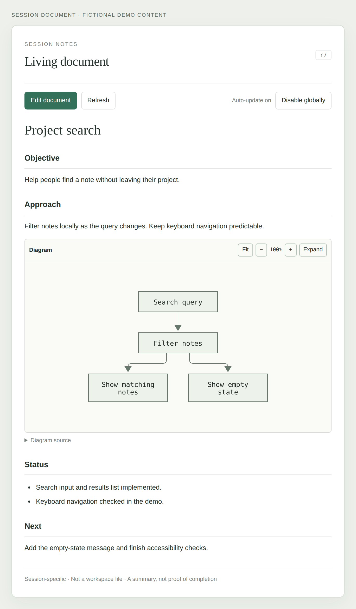
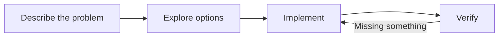

# OpenCode Session Document

A living Markdown document for each OpenCode session. Follow the objective, approach,
decisions, progress, and blockers without losing the thread of the conversation.

- **Session-scoped:** two sessions in the same folder have different documents.
- **Automatic:** enable once, then opening a session creates its document and completed chat turns trigger a background update.
- **Low friction:** the document tab appears on first visit, without replacing another visible panel. Closing it is remembered.
- **Editable:** switch the panel into edit mode and change the Markdown yourself.
- **Visual:** Markdown preview, tables, code blocks, and rendered Mermaid diagrams.
- **Conflict-aware:** manual saves use revision checks; background updates never commit over a newer revision.

## Preview



*The actual plugin panel rendered in an isolated demo with fictional session content.
No live workspace, account, server, or conversation data is shown.*

This is a prototype targeting **OpenCode V2**, developed against the published
`@opencode/plugin` **2.2.0**. The desktop GUI plugin API is experimental. V1 is not supported.

## Install with OpenCode

The Git repository includes self-contained **server, RPC, and desktop GUI**
artifacts. **No manual clone, `npm ci`, or build is needed for a package installation.**
There are no production, optional, or peer package dependencies to fetch from an npm
registry. The native CLI also
registers it without manual configuration editing. A Desktop-managed SSH service
without a CLI on `PATH` can instead use the remote configuration method in section 2A.

**Install the plugin wherever its components run:**

| Your setup | Laptop/desktop installation | Remote installation |
| --- | --- | --- |
| Local sessions only | Required for the panel and local updates | Not needed |
| Remote service managed by Desktop over SSH | Required for the panel | Required in each existing SSH-managed service; see 2A |
| Manually installed remote service | Required for the panel | Required in each remote service; see 2B |

Installing locally does **not** copy or register the plugin on remote servers.
Desktop provisioning the remote OpenCode service does **not** provision this plugin.
There is currently no cross-server installation/synchronization feature in this plugin.

You need OpenCode V2 and GitHub access from each machine. Public HTTPS installation
does not require a GitHub account, token, or SSH key. If the repository is still private
or you use a private fork, the installing account must have Git credentials and access.
If this plugin is already configured through a local path, follow
[the migration instructions](#migrating-an-existing-local-path-installation) first;
do not register both the local checkout and the Git package.

### Restricted npm feeds

Package installation does not need `@opencode/plugin` or other runtime packages
from your npm feed. The SDK helpers and validators used by the server/RPC entrypoints
are bundled; the GUI uses OpenCode's provided host modules and bundles its other
libraries. Your registry settings remain unchanged. Network access to the Git
repository is still required; this is not an offline Git installation.

Third-party code has not been removed or made exempt from organizational approval.
Each bundle ships a component inventory and available upstream license/notice text
in its `.components.json` and `.third-party.txt` companions. These disclosures are
not a complete SBOM, security audit, or approval statement. Follow your organization's
rules for bundled software. Source development still requires build dependencies
and an environment authorized to obtain them.

Version **0.1.1** was tested with **OpenCode 2.2.0** in fresh isolated installations.
Installation, server/RPC/GUI activation, document create/save/read, and the served
GUI bundle checksum all passed. Installation against a deliberately unavailable
test registry also passed, with **zero registry requests**. Neither test enabled
automatic model requests.

### 1. Install on the laptop/desktop

Run the following command in a **local terminal on the laptop/desktop**, not in a
remote session terminal. The native CLI must be available as `opencode`.

Use HTTPS; no GitHub login is needed when the repository is public:

```sh
opencode plugin add 'git+https://github.com/dluc/opencode-session-document.git#main'
```

<details>
<summary>Authentication for a private repository or private fork</summary>

If the repository is still private, authenticate with an account that has access.
GitHub CLI can configure HTTPS Git credentials:

```sh
gh auth login
gh auth setup-git
```

Run authentication setup only on machines that need it. Never put a token in the
installation URL.

</details>

Alternatively, with SSH access already configured:

```sh
opencode plugin add 'git+ssh://git@github.com/dluc/opencode-session-document.git#main'
```

Choose **one** URL form and keep using it for updates/removal. The SSH alternative
requires GitHub SSH authentication even for a public repository; a GitHub CLI login
alone does not necessarily configure SSH. Never put a token in the installation URL.

If you use remote sessions, also complete **2A or 2B on every remote server**.
The local installation supplies the panel; the remote installation performs the
updates and stores documents for remote sessions.

### 2A. Remote service managed by Desktop over SSH

Use this when you add an SSH server in Desktop and Desktop uploads/starts the remote
OpenCode service for you. **Do not install a second OpenCode service.** You only
need to register the plugin with the service that already exists.

1. Connect through Desktop so the managed remote service is running.
2. Open a terminal **on that remote machine**, using the same account as Desktop's
   SSH connection. Ensure that account can reach GitHub. Public HTTPS access needs
   no GitHub login. For a private fork or SSH Git URL, configure credentials on that
   server; your laptop's GitHub authentication is not automatically available there.
3. Add the Git package to the remote service's user-global `opencode.json(c)`.
   The default directory is `~/.config/opencode/`, or
   `$XDG_CONFIG_HOME/opencode/` when the service uses `XDG_CONFIG_HOME`.
   Edit whichever `.json` or `.jsonc` file is already in use; preserve other settings
   and append to the existing `plugins` array rather than replacing it:

   ```jsonc
   {
     "$schema": "https://opencode.ai/config.json",
     "plugins": [
       "git+https://github.com/dluc/opencode-session-document.git#main"
     ]
   }
   ```

4. The running service reloads configuration and installs the missing package.
   Allow installation to finish; use `/reload` in a session on that remote server
   if needed. No manual service installation or restart is required.

The managed `opencode` executable may not be on the remote shell's `PATH`. If you
know the active managed executable's path, you can run its `plugin add` command
instead of editing configuration. Do not hard-code a cached version directory or
install another CLI just to make the bare `opencode` command available.

### 2B. Manually installed remote service

Use this when you or an administrator installed OpenCode on a server and Desktop
connects to that existing service rather than provisioning it over SSH.

1. Open a shell **on the remote machine/container** under the account that owns
   the running OpenCode service. Use its configuration environment, including any
   custom `XDG_CONFIG_HOME`. Running as another account would configure the wrong user.
2. Ensure that account can reach the Git repository. Public HTTPS access needs no
   GitHub login; private forks and SSH Git URLs require the appropriate credentials.
3. Run the existing installation's CLI there:

   ```sh
   opencode plugin add 'git+https://github.com/dluc/opencode-session-document.git#main'
   ```

   If it is not on `PATH`, invoke the executable used by that existing service.
   Do not run this only on your laptop or install a second service.
4. The service reloads its configuration; use `/reload` in a remote session if needed.

For containerized services, make sure the service's configuration, installed plugin
cache, and document storage are persisted as appropriate for that deployment.

**Network access and optional authentication in both remote modes:** the service
account needs outbound access to GitHub, but installation has no npm registry
dependencies. Public HTTPS access needs no GitHub login. For a private fork or an
SSH Git URL, use credentials available to that remote service account. If GitHub CLI
is already available there, `gh auth login` and `gh auth setup-git` can configure
HTTPS credentials for a private repository. SSH access to your server is separate
from SSH access to GitHub. Do not copy a laptop token into the README, plugin options,
or package URL.

### 3. Verify and update each installation

After both sides are installed, open a session on the intended server and enable
automatic documents after reviewing the model-cost notice. **Seeing the panel alone
only confirms the local GUI:** verify that the document loads, saves, and updates in
that remote session too.

Verify, check for updates, and update this plugin (HTTPS example):

```sh
opencode plugin list
opencode plugin check
opencode plugin update 'git+https://github.com/dluc/opencode-session-document.git#main'
```

Run these commands separately for each installed service. For an SSH-managed service
without `opencode` on `PATH`, use its actual managed executable. Reconnecting from
Desktop is not a request to update all remote plugin installations.

To remove a package installation:

```sh
opencode plugin remove 'git+https://github.com/dluc/opencode-session-document.git#main'
```

The `#main` branch tracks the latest prototype. A full Git commit hash can be used
instead when you need a pinned installation; pinned revisions are not updated by
`plugin update`. The plugin is distributed through GitHub rather than npm.
No Bash wrapper is required; the native CLI performs installation and registration.

Native HTTPS Git installation and updates were verified with **OpenCode 2.2.1**
using isolated configuration, data, and cache directories. The smoke test checked
server/RPC/GUI activation, the served GUI bundle against the committed file,
document create/save/read over HTTP RPC, and document preservation across a Git
package update. Automation stayed disabled, so the test made no paid model requests.
SSH is an alternative supported by OpenCode; the smoke test used HTTPS credentials.

### Migrating an existing local-path installation

Before adding the Git package, remove only this plugin's old local-directory entry
from the relevant `opencode.json(c)` file(s), preserving unrelated settings. Do not
configure the same plugin simultaneously through a local path and a Git URL.
Keep the development checkout if you still use it, and do not delete OpenCode's
data directory or document storage. Migrate each machine independently.

Local-directory installations still use `git pull` and a rebuild; `opencode plugin update`
skips them. See the [development installation](#development-installation-on-another-machine)
below and the official [plugin documentation](https://opencode.ai/v2/docs/plugins).

## Build

Requires Node **22.12+** and npm.

```sh
npm ci
npm run check
```

To regenerate the README image, run `npm run docs:screenshot` with Chromium available
(set `CHROME_BIN` if needed). The capture uses the real panel and a deterministic
fictional fixture in a fresh browser profile; it does not connect to an OpenCode
service or make model requests. Review the image before committing it. The capture
script rejects visible URLs/email addresses/user-directory paths and embedded
PNG text or EXIF metadata; these checks complement, rather than replace, visual review.

The build produces the prebuilt server, RPC contract, desktop GUI, component inventories,
and third-party notices. All installable artifacts are committed; all npm dependencies
are development-only. OpenCode loads the compiled server, not the TypeScript source.
After changing source or bundled dependencies, run `npm run check` and commit the
updated artifacts alongside the source. `npm run check:package` checks exported
entrypoints, absence of registry runtime dependencies, and module resolution without
access to this checkout's `node_modules`.

Use **`npm run build:all`** for a complete developer build, `npm run build:runtime`
for server/RPC only, or `npm run build:gui` for GUI only. There is no `npm run build`:
npm interprets a conventional `build` script as a reason to prepare a Git dependency
at installation time. This package deliberately avoids that and other preparation hooks.

## Development installation on another machine

Use this alternative when you want to edit plugin source. For ordinary installation,
use `opencode plugin add` above.

Clone over HTTPS; no GitHub login is needed for a public repository:

```sh
git clone https://github.com/dluc/opencode-session-document.git
cd opencode-session-document
npm ci
npm run build:all
```

If the repository is still private or you are cloning a private fork, configure
Git authentication for an account with access first.

Then register this clone's absolute directory in that machine's OpenCode configuration
as described below. `node_modules` and unrelated build output are not committed;
the runtime artifacts, inventories, and notices are included for Git-package installations.
For Desktop connected to a remote server, install a clone on both the desktop machine
(GUI) and the session server (background updates and storage).

To update an installation without local source changes:

```sh
git pull --ff-only
npm ci
npm run build:all
```

OpenCode watches the local plugin directory and reloads changed components. Use
`/reload` if needed after the update finishes. Existing session documents live in
plugin storage, not in this checkout, and are not overwritten by Git updates.
The update table below explains when only one of the two machines needs updating.

## Try it in OpenCode Desktop

If you installed with `opencode plugin add`, skip the local-path configuration below
and start at step 4. For a remote connection, first install on both machines.

1. For a development installation, make this repository available **on the machine running OpenCode's background service**,
   and build it there. A path in a remote coding environment is not necessarily a path on your desktop.
2. For that development installation, add its absolute directory to `plugins` in your **global**
   `~/.config/opencode/opencode.jsonc` (or its existing `.json` equivalent).
   Preserve your other settings and existing plugin entries:

   ```jsonc
   {
     "$schema": "https://opencode.ai/config.json",
     "plugins": [
       "/absolute/path/to/opencode-session-document"
     ]
   }
   ```

   **Desktop connected to a remote server:** install/register the package on **both**
   machines. Desktop loads the GUI from its own local background server; installing
   only on the remote session server does not make the panel appear. The remote copy
   provides document storage and generation; the laptop copy provides the panel.

3. Configuration reloads automatically. Use `/reload` if a full configuration reload is needed.
4. Open a workspace and session. The **Session document** tab is introduced automatically.
   If another panel is already visible, the tab is appended without replacing that panel;
   otherwise the document is selected. Keyboard focus is not moved into its editor.
5. On first use, click **Enable automatic documents** after reviewing the additional model-cost notice.
   This is a one-time preference for this OpenCode server, across workspaces—not a per-session setup step.
6. This session's document is created automatically. Every subsequent session you visit
   gets its own document without a create click. Existing documents and their pause settings are retained.
7. Chat normally. After a successful completed assistant turn, the document updates automatically.
8. Click **Edit document**, change it, then **Save changes**. The auto-update checkbox can pause this session.

Closing the tab does not stop updates. The plugin remembers that the tab was already introduced,
so switching sessions or reloading the GUI does not continually reopen it. To reopen it, select
**Open session document** in the command palette, use `/session-document` in the composer menu,
or choose **Session document** from the panel's **+** menu.

Use **Disable globally** in a document toolbar, or the **Session documents** page in Settings,
to stop automatic creation and background updates across workspaces on that server. Saved content
is retained. A model request already sent may still finish and incur costs; its candidate is
discarded when the changed automation policy is detected. Re-enabling does not clear individual session pauses.

No global configuration is modified by this repository's build or tests.
For UI development, `npm run dev` rebuilds the bundle and the desktop app reloads the local GUI plugin.

### Which copy needs updating?

| Change | Remote session server | Desktop/laptop |
| --- | --- | --- |
| Summary prompt, brief limits, updater logic | Update and run `npm run build:runtime` | No update needed |
| Panel layout, editor, Markdown rendering | Usually unchanged | Update and run `npm run build:gui` |
| Shared RPC/schema changes | Update | Update and rebuild |
| Full release with mixed changes | Update | Update and rebuild |

This table describes development checkouts. Native Git-package users instead run
`opencode plugin update` with the configured Git target on the indicated machine(s),
without a local build.

OpenCode watches the compiled plugin artifacts and reloads them after changes.
In development, source edits require a rebuild before they affect the installed plugin.
Use `/reload` if necessary; a service restart is not required. Server-only policy changes
that do not alter the RPC contract work with the existing laptop panel.
After updating the server, click **Refresh** to condense an existing long document,
or wait for the next completed conversational turn. Updates must be enabled globally
and for that session. Existing documents are not destructively truncated during installation.

### Mermaid example

Paste this into the document editor, save, and view the preview:

````markdown
## Approach


````

Diagram source remains available in a disclosure below each rendered diagram.
Diagrams use SVG text labels (not embedded HTML) and initially fit inside a
height-limited viewer. **Fit**, **− / +**, and **Expand / Collapse** controls let you
inspect complex diagrams. Zooming scrolls inside the viewer rather than making
the entire document several screens tall. Fit responds to panel resizing.
Invalid diagrams leave their source readable. Custom Mermaid configuration directives
are disabled and diagrams use a safe monochrome style; raw HTML, external images,
and SVG styles are restricted to prevent script execution and silent external requests.

## Manual trial checklist

- Open session A; verify that its document tab appears without replacing another visible panel.
- Enable automatic documents once; verify that A's document is created without a separate create click.
- Describe an objective and wait for the assistant to finish.
- Verify that the panel summarizes the objective without claiming unperformed work is complete.
- Add a manual note and a Mermaid diagram; save and inspect the preview.
- Continue chatting; check that the note is preserved and the document evolves appropriately.
- Keep an unsaved draft open while another turn finishes. The draft must remain intact;
  a newer revision should prompt comparison rather than silently overwrite it.
- Open session B in the same folder. Its own document must be created automatically, without A's content.
- Switch back to A, including with an unsaved draft. Its content should be restored.
- Pause automatic updates in edit mode, save, and confirm later turns do not update it.
- Close the panel, switch away/back, and reload the GUI. The plugin must not force it open again.
- Reopen it from the command palette. Saved content must remain available, including updates from while it was closed.
- Disable globally; verify that new sessions get no document and existing documents receive no automatic updates.

## How it works

```text
Session status: idle
        │
        ▼
Existing document + new completed assistant turn?
        │ yes
        ▼
Transient session.generate request (no chat message or tool execution)
        │
        ▼
Same conversation turn and same document revision?
        ├── no  → discard stale result
        └── yes → save revision → publish change event → panel refreshes
```

The GUI and updater use a shared document service. Reads and writes go through plugin
RPC; the GUI targets the session's actual server and workspace location. Model output
is treated as untrusted Markdown.

The one-time automation preference is stored in server-side plugin storage and checked
before generation and before accepting its result. The GUI checks it before automatically
creating documents on session visits. The per-session tab-introduction flag uses OpenCode's
persisted GUI session store. Disabling globally does not erase or change a session's pause flag.

Only one generation runs per session at a time; repeated idle events are coalesced.
A 30-second reconciliation loop recovers missed events and unfinished work after reload.
Failed generations retain the old document and do not retry the same turn indefinitely;
**Refresh** explicitly retries, and a new completed turn is eligible again.

### Current-state brief, not session history

The generated portion targets **300–450 words** with hard limits of **600 words**
and **6,000 characters**, including Markdown and diagram source. It focuses on the current
objective, chosen approach, consequential decisions, actual status, and immediate next steps.
Superseded plans, resolved troubleshooting, repeated facts, and exhaustive implementation
details are condensed or removed. Existing long documents are condensed on their next update.

At most one Mermaid diagram of up to 30 source lines is accepted. If the generated
brief violates the limits, the server makes **one** corrective request. If that still
fails, the old document is retained with a visible error; no text is blindly truncated
and no unlimited retry loop is started. Normal updates use one model request; a
corrective attempt may add one more, with corresponding costs.

To preserve specific manual notes **verbatim**, wrap them in these markers in edit mode:

```markdown
<!-- session-document:keep -->
## My notes
Keep this exact wording, even if the automatic brief is shortened.
<!-- /session-document:keep -->
```

These blocks are extracted before generation and reattached unchanged after the brief.
They do not count toward the brief's limits, but the complete document still has the
100,000-character storage limit. Thus deliberately long pinned notes can still make
the overall document long. Ordinary unpinned prose can be consolidated by the model.
Always close the marker pair; an unmatched marker prevents the automatic update
rather than risking removal of the note.

### Storage and privacy

- Saved documents live in OpenCode's durable plugin storage, keyed by session ID—not in Git or a workspace file.
- Unsaved editor drafts are backed up in app-window local storage, keyed by server and session.
  Saving or explicitly cancelling an edit removes that local draft.
- Automatic updates use the session's configured model and available session context, including
  its compaction summaries. Each processed turn normally makes an additional model request;
  one extra shortening request is allowed if the first answer exceeds the brief limits. Both may incur costs.
- Do not use this as a secrets store. A prompt asks the updater not to copy credentials,
  but that is not a guarantee of automatic redaction. The model still receives the session context.
- The document is **not injected into agent instructions**. It records work; it does not authorize actions or prove completion.

### Concurrent editing

Every content change has a revision. If another save lands while you edit, your draft
remains in the editor. Choose **Compare with latest**, merge the differences into your
draft, acknowledge the newer revision, and save again. No automatic conflict resolution
or forced overwrite is performed.

A background candidate is discarded when a manual save or a new turn makes it stale.
It can update again after a later turn, or you can use **Refresh** when not editing.
The model is instructed to preserve manual wording, but semantic preservation across
future generated revisions remains model-dependent for unpinned prose; review important notes.
Use the protected-note markers above for text that must be retained exactly.

## Project layout

```text
src/
  index.ts       Server plugin: RPC, event listener, recovery
  document.ts    Validated records, serialized writes, revisions
  preferences.ts One-time enablement and server-wide disable policy
  updater.ts     Background generation and stale-result handling
  brief.ts       Generated-content budgets and protected manual notes
  rpc.ts         Shared typed contract
  gui.tsx        Desktop panel and editor
  render.ts      Markdown/SVG sanitization
  diagram.ts     Mermaid configuration, SVG labels, fit/zoom/expand viewer
  panel.css      Panel styling
tests/           Unit, DOM, and mocked server integration tests
```

## Verification and limitations

```sh
npm run check
npm audit
```

For real Chromium rendering checks, without installing another test dependency:

```sh
CHROME_BIN=/path/to/chrome npm run test:browser
```

The script also discovers common local Chromium locations. It uses an isolated
temporary browser profile and a localhost Vite fixture; no OpenCode session or
paid model request is involved. It checks actual labels, diagram dimensions,
fit/zoom/expand controls, and narrow-panel resizing for flowchart, sequence, and
state diagrams. `npm run check` remains browser-independent.

Tests cover session isolation, persistence, conflicting saves, duplicate updates,
stale generation, failure retention, cleanup, panel editing/session switching,
one-time enablement, automatic tab/document creation, non-intrusive tab selection,
close/return behavior, global disable, and rendering safety.
They do not invoke a paid model or a live OpenCode service.

Unit/DOM tests use mocked hosts, while the Chromium checks exercise actual diagram
rendering. Native Git installation and RPC were additionally tested against a real
isolated OpenCode 2.2.1 service as described above. These checks do **not** substitute
for a full Desktop UI trial or verification of real-model summary quality; use the
manual trial checklist for those. A passing bundle build alone is not a live-app test.

Other current limitations:

- The full Mermaid renderer is bundled because GUI plugins must ship one self-contained
  CommonJS file. The bundle is roughly 5.3 MB before compression.
- Automatic updates follow completed successful text turns, not every streamed token,
  interrupted turn, or intermediate tool call.
- Moving a session to a different workspace location may require recreating its document
  if that OpenCode version scopes plugin storage by location. Migration is not implemented.
- Document history/export/deletion UI is not implemented yet.
- Deleting a session does not currently explicitly remove its document record from plugin storage.

## License

Original project code is licensed under the [MIT License](LICENSE).
Bundled third-party components retain their own licenses; see the generated
component inventories and third-party notices shipped with each bundle.

The `private: true` package flag prevents accidental npm publication. It does not
control GitHub repository visibility or restrict the MIT license.

## References

- [Server plugins](https://opencode.ai/v2/docs/build/plugins/server)
- [GUI plugins](https://opencode.ai/v2/docs/build/plugins/gui)
- [Plugin RPC](https://opencode.ai/v2/docs/build/plugins/rpc)
